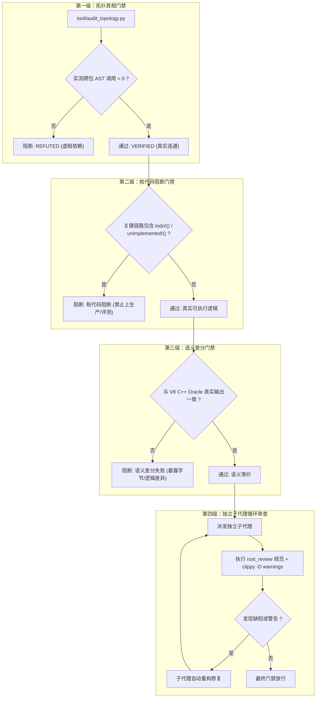

# v8rs 审查与确定性验证流程规范

> 借鉴 [git/reverify](file:///Users/z/git/js/v8rs/git/reverify) 核心哲学：**“AI 提出主张，确定性工具裁决事实；唯有经实证检验的主张才被采纳。”**

---

## 1. 目标与反幻觉准则

在 V8 从 C++ 迁移到 Rust 的超大规模（94+ crate）工程中，AI 极易在以下三处产生幻觉：
1. **拓扑虚假连接**：在 `Cargo.toml` 中声明了依赖，但在 `src/` 中实际零调用，谎称“已打通链路”。
2. **桩代码伪全绿**：用 `todo!()`、`unimplemented!()` 或空函数体填充逻辑，单测仅覆盖极窄纯函数分支，造成测试 100% 通过的“假象全绿”。
3. **语义偏移**：Rust 重写的结构体字段偏移、位图翻转、浮点与整数溢出行为与 Google V8 C++ 实际逻辑不一致。

---

## 2. 四级确定性审核门禁



---

## 3. 工具链与可执行命令

本流程受 [mise](file:///Users/z/git/js/v8rs/.mise.toml) 与 [uv](file:///Users/z/git/js/v8rs/pyproject.toml) 统一环境驱动：

1. **环境初始化**：
   ```bash
   mise run reverify-sync
   ```
2. **拓扑与桩代码确定性审计**：
   ```bash
   mise run audit-topology
   # 或
   uv run tool/audit_topology.py
   ```
3. **全仓无回归测试**：
   ```bash
   ./test.sh
   ```
4. **编译期严格警告清零**：
   ```bash
   cargo clippy --workspace --benches --all-targets -- -D warnings
   ```

---

## 4. 派发子代理审查指引

主代理在任何修改提交或阶段收口前，必须遵照 `AGENTS.md` 派发独立子代理：
1. **角色设定**：顶级 Rust 架构师与代码审查专家。
2. **审查输入**：近期修改的 crate 列表及 [SKILL.md](file:///Users/z/git/js/v8rs/.agents/skills/rust_review/SKILL.md)。
3. **硬性指标**：
   - 零 `#[allow(...)]` 绕过。
   - 零非必要堆分配与 `mut` 绑定。
   - 零未处理的警告（`-D warnings`）。
   - 100% 单元测试通过。
4. **循环退出条件**：子代理反复迭代修复，直至所有检查项零错误、零警告且回归测试全绿。
