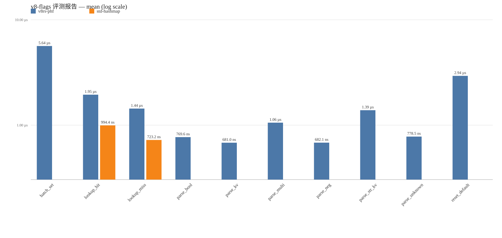

# v8-flags 评测报告

本评测用 criterion 对 v8-flags 的核心操作做基准测量:
按名查找 (phf 静态表 vs std HashMap 动态表)、flag 字符串解析、批量设置与默认值重置。
flag 语义为自研实现 (todo 10.2 红线, 不引入 clap); 解析/批量/重置类操作无对比库,
仅由 v8rs-phf 单实现测量, 报告中对比实现以 — 标记。
相对值以 v8rs-phf 为基线, 小于 1 表示对比实现更快。

生成时间: 2026-10-11T07:54:00.788Z

| 操作 | v8rs-phf (mean) | std-hashmap (mean) | std-hashmap 相对基线 |
| --- | --- | --- | --- |
批量 set_from_string (64 个 flag) | 5.64 µs | — | —
按名查找命中 (每迭代 64 次) | 1.95 µs | 994.4 ns | 0.51×
按名查找未命中 (每迭代 64 次) | 1.44 µs | 723.2 ns | 0.50×
解析 --flag (布尔置位) | 769.6 ns | — | —
解析 --flag=值 (整数) | 681.0 ns | — | —
解析多 flag 串 (空格分隔) | 1.06 µs | — | —
解析 --no-flag (布尔取反) | 682.1 ns | — | —
解析 --flag=值 (字符串) | 1.39 µs | — | —
解析未知 flag (错误路径) | 778.5 ns | — | —
默认值重置 | 2.94 µs | — | —

> 基线实现: v8rs-phf (phf 编译期完美散列静态表)

数据表: [bench-table.csv](bench-table.csv) · 原始数据: [bench-result.json](bench-result.json)
